```{r}
#| label: setup
#| include: false
here::i_am("Documentation/Presentations/BES_2026/index.qmd")


base::source(
  here::here(
    "Documentation",
    "Presentations",
    "BES_2026",
    "R",
    "load_bes_functions.R"
  )
)

load_bes_functions()

list_results_snapshot <-
  load_results_snapshot(
    path = here::here(
      "Documentation",
      "Presentations",
      "BES_2026",
      "results_snapshot.json"
    )
  )

number_of_cores <-
  format_count(
    list_results_snapshot[["summary_counts"]][["cores"]]
  )

number_of_samples <-
  format_count(
    list_results_snapshot[["summary_counts"]][["communities"]]
  )

number_of_taxa <-
  format_count(
    list_results_snapshot[["summary_counts"]][["taxa"]]
  )

number_trait_values <-
  format_count(
    list_results_snapshot[["summary_counts"]][["trait_values"]]
  )

number_of_functional_types <-
  format_count(
    list_results_snapshot[["summary_counts"]][["functional_types"]]
  )

number_of_models <-
  format_count(
    list_results_snapshot[["summary_counts"]][["models"]]
  )

list_oracle_design <-
  load_design_config(
    path = here::here(
      "Documentation",
      "Presentations",
      "BES_2026",
      "design_config.json"
    )
  )

vec_oracle_palette <-
  list_oracle_design |>
  purrr::chuck(
    "config",
    "palette"
  )

make_gif_poster <- function(file_name) {
  path_gif <-
    here::here(
      "Documentation",
      "Presentations",
      "BES_2026",
      "figures",
      "results",
      file_name
    )

  path_poster <-
    stringr::str_replace(
      string = path_gif,
      pattern = "[.]gif$",
      replacement = "_poster.png"
    )

  vec_frames <-
    magick::image_read(path = path_gif)

  magick::image_write(
    image = vec_frames[base::length(vec_frames)],
    path = path_poster
  )

  path_poster
}

```

## BIODYNAMICS PROJECT {.slide-title .slide-planet-bg .screen-corners .screen-header .screen-prompt .screen-link-oracle}

<!-- slide:00 -->

::: {.planet-scanlines}
:::

:::: {.columns}
::: {.column .panel-line-left .padding-left-large .padding-top-small .padding-bottom-small width="100%"}

[talking to \<ORACLE\>:]{.display-block .text-weight-heading .text-line-height-title .margin-bottom-large .text-shadow-dim .text-uppercase .text-size-heading .text-color-cyan}

[Exploring biotic signals in vegetation assembly from the LGM to the Anthropocene]{.display-block .text-weight-heading .text-line-height-title .margin-bottom-large .text-uppercase .text-size-heading-large .text-color-green .text-shadow .text-line-under .padding-bottom-large}

<br>
<br>

[Ondrej Mottl]{.text-size-title .text-color-purple}

[BES Annual Meeting 2026 || 14–17 December 2026 || Online]{.text-size-title-small .text-color-amber}

<br>
<br>
<br>

:::

::::

:::: {.columns .panel-line-top .margin-top-large .padding-top-small}

::: {.column width="33%"}
::: {.text-color-muted .text-letter-spacing-status .text-uppercase .text-position-center}
NARRATIVE INTERFACE: **ORACLE**
:::
:::

::: {.column width="33%" .text-position-center .text-color-muted}
.../.../...
:::

::: {.column width="33%"}
::: {.text-color-muted .text-letter-spacing-status .text-uppercase .text-position-center}
ANALYTICAL  OUTPUTS: **REAL**
:::
:::

::::

::: {.notes}
Hello and welcome to my talk!
I would like to try something a little different: science should be serious, but also a bit fun.
So please close your eyes and imagine that we are on a spaceship, and our goal is to examine the vegetation of a strange planet called Earth.
We will use the ship's supercomputer, ORACLE.
All the data, analyses and results you will see are real.
The supercomputer is not; it is only a narrative device.
:::

<!-- slide:01 -->
## [... booting]{.fragment .fragment-terminal data-fragment-index="0"} {.slide-terminal .slide-terminal-story}

:::: {.columns}
::: {.column width="50%" .fragment .tui-reveal-scan}
{.image-display-block .margin-x-auto .image-height-750 .image-blend-screen .image-fit-contain .width-full}
:::

::: {.column width="50%" .fragment}
::: {.oracle-terminal}

::: {.oracle-line}
[System online]{.text-emphasis-chip}
:::

[]{.oracle-line}

::: {.oracle-line}
Greetings Dr. Mottl
:::

[]{.oracle-line}

::: {.oracle-line}
I am [O]{.text-emphasis-underline}bservational [R]{.text-emphasis-underline}untime for [A]{.text-emphasis-underline}nalysis of [C]{.text-emphasis-underline}ommunity-[L]{.text-emphasis-underline}evel [E]{.text-emphasis-underline}cology
:::

::: {.oracle-line}
[\<ORACLE\>]{.text-emphasis-chip .text-emphasis-underline-double} for short
:::

[]{.oracle-line}

::: {.oracle-line}
I am here to assist you in analyzing vegetation patterns on Earth
:::

[]{.oracle-line}

::: {.oracle-line}
[Awaiting ecological query.]{.text-emphasis-chip}
:::

[]{.oracle-line}

[]{.oracle-line}

::: {.oracle-line}
Proceed? [Y]/[N]?
:::
:::

:::
::::

::: {.notes}
Welcome, fellow scientists, you may open your eyes!
I am Ondřej Mottl, the chief researcher on this ship.
We have about 15 minutes with ORACLE, the Observational Runtime for Analysis of Community-Level Ecology, to explore the vegetation of planet Earth.
ORACLE has introduced itself, so let's get started.
:::

<!-- slide:02a -->
## {.slide-terminal .slide-terminal-question}

<br>
<br>
<br>

::: {.text-size-heading-large .text-weight-heading .text-line-height-title .margin-bottom-large .text-shadow-dim .text-emphasis-box .text-position-center}

[Is there a [scale dependence]{.text-bold .text-color-spatial .text-emphasis-underline} in the amount of [unexplained variation]{.text-emphasis-underline-dotted} (potentially due to [biotic interactions]{.text-color-latent}) structuring vegetation since the [Last Glacial Maximum]{.text-emphasis-underline-dotted}?]{.text-size-heading-large .fragment}

:::

:::{.notes}
The question of this talk is: is there a scale dependence in the amount of unexplained variation that structures vegetation since the Last Glacial Maximum?
We know that climate and spatial processes explain a lot, but I am interested in what remains, which could partly reflect biotic interactions: competition, facilitation, or shared pollinators and herbivores.
We would expect this part to change with scale; for example, interactions should be easier to detect at local than at continental scales.
:::

<!-- slide:02 -->
## [Is there a [scale dependence]{.text-bold .text-emphasis-underline} in the amount of [unexplained variation]{.text-emphasis-underline-dotted} (potentially due to [biotic interactions]{.text-color-latent}) structuring vegetation since [LGM]{.text-emphasis-underline-dotted}?]{.fragment .fragment-terminal data-fragment-index="0"} {.slide-terminal .slide-terminal-question}

:::: {.columns}

::: {.column width="35%" .fragment data-fragment-index="1"}

<br>
<br>
<br>

::: {.oracle-terminal}

::: {.oracle-line}
Query accepted
:::

[]{.oracle-line}

::: {.oracle-line}
Plan to [partition]{.text-emphasis-underline} observed plant co-occurrence into:
:::

[]{.oracle-line}

::: {.oracle-line}
[spatial]{.text-highlight-spatial} structure
:::

::: {.oracle-line}
[climate]{.text-highlight-abiotic} response
:::

::: {.oracle-line}
[species-species association]{.text-highlight-latent} (residual)
:::
:::

:::

::: {.column width="21%" .fragment .tui-reveal-scan data-fragment-index="2"}
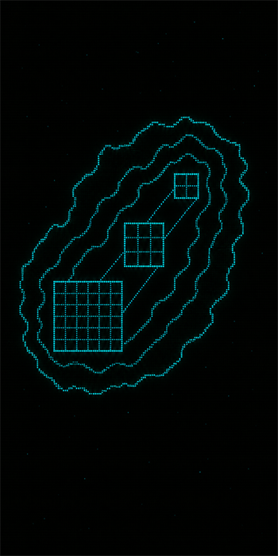{.image-display-block .margin-x-auto .image-blend-screen .image-fit-contain .width-full .image-height-750}
:::

::: {.column width="21%" .fragment .tui-reveal-scan data-fragment-index="3"}
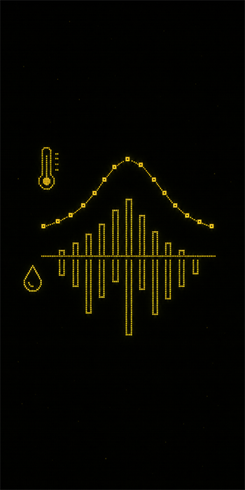{.image-display-block .margin-x-auto .image-blend-screen .image-fit-contain .width-full .image-height-750}
:::

::: {.column width="21%" .fragment .tui-reveal-scan data-fragment-index="4"}
{.image-display-block .margin-x-auto .image-blend-screen .image-fit-contain .width-full .image-height-750}
:::

::::

::: {.notes}
So, ORACLE: is there a scale dependence?
ORACLE proposes to partition the observed plant co-occurrence into three components: spatial structure, shown in blue throughout; the climate response, in yellow; and the residual species-species association, in purple.
:::

<!-- slide:03 -->
## [DATA: [\<VegVault\>]{.text-emphasis-chip}]{.fragment .fragment-terminal data-fragment-index="0"} {.slide-terminal .slide-terminal-methods}

```{r}
#| label: result-slide03-generate
#| eval: false
#| include: false
#| cache: true
source(
  here::here(
    "Documentation/Presentations/BES_2026/R/Visualisation/Data_ingestion_schematic_figure.R"
  )
)

source(
  here::here(
    "Documentation/Presentations/BES_2026/R/Visualisation/northern_hemisphere_coverage_figure.R"
  )
)
```

:::: {.columns}

::: {.column width="0%"}
:::

::: {.column width="50%" }

::: {.fragment .tui-reveal-blur data-fragment-index="2"}

```{r}
#| label: result-slide03-ingestion-build
#| eval: false
#| echo: false
#| warning: false
#| message: false
#| include: true
#| cache: true
source(
  here::here(
    "Documentation/Presentations/BES_2026/R/Visualisation/Data_ingestion_schematic_figure.R"
  )
)
```

```{r}
#| label: result-slide03-ingestion-render
#| echo: false
#| out-width: 95%
knitr::include_graphics(
  here::here(
    "Documentation/Presentations/BES_2026/figures/results/slide_03_ingestion_schematic.png"
  )
)
```

:::

::: {.fragment .tui-reveal-blur data-fragment-index="3"}

USED SAMPLE COVERAGE

```{r}
#| label: result-slide03-coverage-build
#| eval: false
#| echo: false
#| warning: false
#| message: false
#| include: true
#| cache: true
source(
  here::here(
    "Documentation/Presentations/BES_2026/R/Visualisation/northern_hemisphere_coverage_figure.R"
  )
)
```

```{r}
#| label: result-slide03-coverage-render
#| echo: false
#| out-width: 95%
knitr::include_graphics(
  here::here(
    "Documentation/Presentations/BES_2026/figures/results/slide_03_northern_hemisphere_coverage.png"
  )
)
```

:::

:::

::: {.column width="50%" }
::: {.oracle-terminal .fragment data-fragment-index="1"}

::: {.oracle-line}
[\<VegVault\>]{.text-emphasis-chip} database: publicly available, open-source database
:::

[]{.oracle-line}

::: {.oracle-line}
[Community records]{.text-emphasis-box}, [climate predictors]{.text-color-abiotic}, [site coordinates]{.text-color-spatial}, and [functional traits]{.text-color-latent} are loaded as separate streams
:::

[]{.oracle-line}

::: {.oracle-line}
Due to [data availability]{.text-emphasis-underline-dotted}, I will focus on the [Northern Hemisphere]{.text-emphasis-underline-double} of the planet since the [LGM]{.text-emphasis-underline-double}
:::
:::

::: {.fragment .tui-reveal-scan data-fragment-index="4"}

:::: {.columns .image-height-750}

::: {.column width="50%"}
{.absolute .image-display-block .image-theme-bg-dark top=0 left=50 width="300" height="300"}
:::

::: {.column width="50%"}
```{r}
#| label: QR code https://bit.ly/VegVault 
#| echo: false
#| eval: false
#| output: false
#| cache: true
save_qr_code(
  url = "https://bit.ly/VegVault",
  name = "vegvault",
  background_color = vec_oracle_palette[["background"]],
  foreground_color = vec_oracle_palette[["phosphor"]],
  plot = FALSE
)
```

{.absolute .image-display-block top=0 right=0 width="300" height="300"}
:::

::::

:::

:::
::::

::: {.notes}
For the data we use VegVault, an open database that combines vegetation plots, fossil pollen records, contemporary and past climate, and functional traits.
The database is global, but here we focus on the Northern Hemisphere, with the strongest coverage in North America and Europe, plus Asia.
VegVault is described in a paper in Scientific Data, and you can reach it through the QR code.
:::

<!-- slide:04 -->
## [Preparing [community]{.text-emphasis-box} and [climate]{.text-highlight-abiotic} streams]{.fragment .fragment-terminal data-fragment-index="0"} {.slide-terminal .slide-terminal-methods}


:::: {.columns}

::: {.column width="40%"}

<br>

::: {.oracle-terminal .fragment data-fragment-index="1"}

::: {.oracle-line}
Data extracted, now [preparing]{.text-emphasis-underline-dotted} ...
:::

[]{.oracle-line}

::: {.oracle-line}
[[Community]{.text-emphasis-box} stream normalised]{.text-emphasis-underline}
:::

::: {.oracle-line}
 - proportions filtered
:::

::: {.oracle-line}
 - Taxa are classified [automatically]{.text-emphasis-underline-dotted} against GBIF and filtered
:::

::: {.oracle-line}
 - [Age uncertainty]{.text-highlight-temporal} [propagated]{.text-emphasis-underline-dotted} to estimate counts
:::


[]{.oracle-line}

::: {.oracle-line}
[[Climate]{.text-highlight-abiotic} stream screened]{.text-emphasis-underline}
:::

::: {.oracle-line}
 - [Redundant]{.text-emphasis-underline-dotted} predictors are [removed]{.text-emphasis-underline-dotted} before model fitting
:::
:::


:::

::: {.column width="5%"}
:::

::: {.column width="60%" .fragment .tui-reveal-blur data-fragment-index="2" }

```{r}
#| label: result-slide05-workflow-build
#| echo: false
#| warning: false
#| message: false
#| include: true
#| cache: true
#| eval: false
source(
  here::here(
    "Documentation/Presentations/BES_2026/R/Visualisation/climate_data_summary_figure.R"
  )
)
```

```{r}
#| label: result-slide05-workflow-render
#| echo: false
#| out-width: 90%
#| eval: true
knitr::include_graphics(
  here::here(
    "Documentation/Presentations/BES_2026/figures/results/slide_05_climate_screening.png"
  )
)
```

<!-- Let's keep the mermaid as backup -->

::: {.oracle-mermaid .oracle-mermaid-process}

```{mermaid}
%%| label: slide05-community-climate-mermaid
%%| eval: false
%%{init: {
  "theme": "base",
  "flowchart": {
    "curve": "basis",
    "htmlLabels": true,
    "nodeSpacing": 22,
    "rankSpacing": 14,
    "padding": 10
  }
}}%%
flowchart TB
  source["VegVault"]

  subgraph community_stream [" "]
    direction TB
    community_title["COMMUNITY STREAM"]
    community_counts["counts<br/>proportions"]
    community_age["interpolation<br/>with uncertainty"]
    community_taxa["taxonomy<br/>harmonisation"]
    community_filters["Select<br/>resolution"]
    community_title ~~~ community_counts
    community_counts --> community_age --> community_taxa --> community_filters
  end

  subgraph climate_stream [" "]
    direction TB
    climate_title["CLIMATE STREAM"]
    climate_vars["CHELSA<br/>candidates"]
    climate_variance["drop invariant<br/>predictors"]
    climate_screen["select<br/>non-collinear set"]
    climate_grid["interpolate"]
    climate_title ~~~ climate_vars
    climate_vars --> climate_variance --> climate_screen --> climate_grid
  end

  sample_filtering["Sample filtering<br/>spatial/temporal"]
  core_filtering["Core filtering"]

  model["Model"]

  source --> community_counts
  source --> climate_vars
  community_filters --> sample_filtering
  climate_grid --> sample_filtering

  sample_filtering --> core_filtering

  core_filtering --> model


  class source,sample_filtering,core_filtering source_node
  class community_title community_title_node
  class climate_title climate_title_node
  class community_counts,community_age,community_taxa,community_filters community_node
  class climate_vars,climate_variance,climate_screen,climate_grid climate_node
  class model model_node
```

:::


:::
::::

::: {.notes}
Next, the data need processing; I will only mention the main steps.
Pollen counts are turned into proportions and interpolated to 500-year steps, carrying the age uncertainty from the age-depth models.
Taxonomy is harmonised to the GBIF backbone, so we can choose the resolution, genus or family.
For climate, we use CHELSA bioclimatic variables, drop constant predictors, keep a non-collinear set and interpolate them to the same 500-year steps.
Finally, we keep only units with enough samples and cores.
:::

<!-- slide:05 -->
## [Model core: [environment]{.text-color-abiotic}, [space]{.text-color-spatial}, [association]{.text-color-latent}]{.fragment .fragment-terminal data-fragment-index="0"} {.slide-terminal .slide-terminal-methods}

:::: {.columns}

::: {.column width="10%"}
:::

::: {.column width="45%"}

<br>
<br>

::: {.text-equation .text-size-heading-small}

[$Y_{ij} \sim \operatorname{Bernoulli}\!\left\{\Phi\!\left(\eta_{ij}\right)\right\}$]{.text-equation-line .fragment data-fragment-index="2"}

<br>

::: {.text-equation-linear-predictor}
::: {.text-equation-row .fragment data-fragment-index="3"}
[$\eta_{ij} = \alpha_j \;+\;$]{.text-equation-base}
:::

::: {.text-equation-row .fragment data-fragment-index="4"}
[$\sum_{k=1}^{K}\,\beta_{jk}\,x_{ik} \;+\; \sum_{k=1}^{K}\,\gamma_{jk}\,x_{ik}\,a_i$]{.text-color-abiotic .text-equation-continuation}
[$\;+\;$]{.text-equation-base}
:::

::: {.text-equation-row .fragment data-fragment-index="5"}
[$\sum_{m=1}^{M}\,\delta_{jm}\,\operatorname{MEM}_{im}$]{.text-color-spatial .text-equation-continuation}
[$\;+\;$]{.text-equation-base}
:::

::: {.text-equation-row .fragment data-fragment-index="6"}
[$u_{ij}$]{.text-color-latent .text-equation-continuation}
:::
:::

<br>

::: {.fragment data-fragment-index="7"}
[$\mathbf{u}_i = (u_{i1}, \ldots, u_{iJ}) \sim \mathcal{N}(\mathbf{0}, \Sigma)$]{.text-color-latent .text-equation-line}
:::
:::

:::

::: {.column width="35%" .fragment data-fragment-index="1"}

::: {.oracle-terminal}

::: {.oracle-line}
[Model assembled.]{.text-emphasis-chip}
:::

[]{.oracle-line}

::: {.oracle-line}
[\{sjSDM\}]{.text-emphasis-underline-double} as the modeling framework
:::

[]{.oracle-line}

::: {.oracle-line}
[Abiotic predictors]{.text-highlight-abiotic} explain shared response
:::

[]{.oracle-line}

::: {.oracle-line}
[Moran Eigenvector Maps]{.text-highlight-spatial} (MEMs) absorb spatio-temporal autocorrelation
:::

[]{.oracle-line}

::: {.oracle-line}
[Residual covariance]{.text-highlight-latent} carries species-species association signal
:::

:::
:::
::::

::: {.text-equation-meta .text-size-body .fragment data-fragment-index="8"}
[Env]{.text-highlight-abiotic}[: `~ (x1 + ... + xK) * age - age`]{.text-color-abiotic}

[Space]{.text-highlight-spatial}[: `~ 0 + (MEM1 + ... + MEMM)`]{.text-color-spatial}

[Association]{.text-highlight-latent}[: off-diagonal `Sigma` from `sjSDM::bioticStruct()`]{.text-color-latent}
:::

::: {.notes}
For the model we use sjSDM, a scalable joint species distribution model that runs on graphics cards and so copes with very large datasets.
For the spatial models, the regularisation of each model is selected by cross-validation that holds out whole sites.
Now a little maths: the response is presence or absence.
The linear predictor has an intercept; the climate predictors and their interaction with time, because the response to climate may change through time; Moran eigenvector maps, which absorb spatial and temporal autocorrelation; and the residual species-species association.
:::

<!-- slide:06 -->
## [Variance decomposition]{.fragment .fragment-terminal data-fragment-index="0"} {.slide-terminal .slide-terminal-methods}

:::: {.columns}

::: {.column width="50%" .fragment data-fragment-index="1"}

<br>
<br>
<br>
<br>

::: {.oracle-terminal}

::: {.oracle-line}
Decomposition ready
:::

[]{.oracle-line}

::: {.oracle-line}
Focus: [residual association component]{.text-highlight-latent}
:::

[]{.oracle-line}

::: {.oracle-line}
Report what remains after [climate]{.text-highlight-abiotic} and [spatial structure]{.text-highlight-spatial} have made their claims
:::

[]{.oracle-line}

::: {.oracle-line}
[Caution]{.text-highlight-warning}: co-occurrence is not proof of [interaction]{.text-color-warning}.
:::

:::
:::

::: {.column width="50%"} 

<br>

::: {.fragment .tui-reveal-blur data-fragment-index="2"}
```{r}
#| label: result-slide06-decomposition-build
#| echo: false
#| warning: false
#| message: false
#| include: true
#| cache: true
#| eval: false
source(
  here::here(
    "Documentation/Presentations/BES_2026/R/Visualisation/variance_decomposition_triangle_figure.R"
  )
)

source(
  here::here(
    "Documentation/Presentations/BES_2026/R/Visualisation/variance_decomposition_example_figure.R"
  )
)
```

```{r}
#| label: result-slide06-decomposition-render
#| echo: false
#| out-width: 90%
#| eval: true
knitr::include_graphics(
  here::here(
    "Documentation/Presentations/BES_2026/figures/results/slide_06_variance_decomposition.png"
  )
)
```

:::

:::: {.columns}

::: {.column width="70%" .fragment .tui-reveal-blur data-fragment-index="3"}
```{r}
#| label: result-slide06-component-stack-render
#| echo: false
#| out-width: 90%
#| eval: true
knitr::include_graphics(
  here::here(
    "Documentation/Presentations/BES_2026/figures/results/slide_06_component_stack_example.png"
  )
)
```

:::

::: {.column width="30%" .fragment .tui-reveal-blur data-fragment-index="4"}
```{r}
#| label: result-slide06-component-point-render
#| echo: false
#| out-width: 50%
#| eval: true
knitr::include_graphics(
  here::here(
    "Documentation/Presentations/BES_2026/figures/results/slide_06_component_point_example.png"
  )
)
```

:::

::::

:::

::::

::: {.notes}
Once a model is fitted, we decompose its explained variance into climate, space and association.
In this example, about 60% goes to climate, 30% to space and 10% to association.
We can also merge the three numbers into one colour on this colour triangle: the more purple a point, the more residual association in that model.
:::

<!-- slide:07 -->
## [Three analysis axes]{.fragment .fragment-terminal data-fragment-index="0"} {.slide-terminal .slide-terminal-methods}

<br>

:::: {.columns}

::: {.column width="33%" .text-position-center .fragment .tui-reveal-scan data-fragment-index="2"}

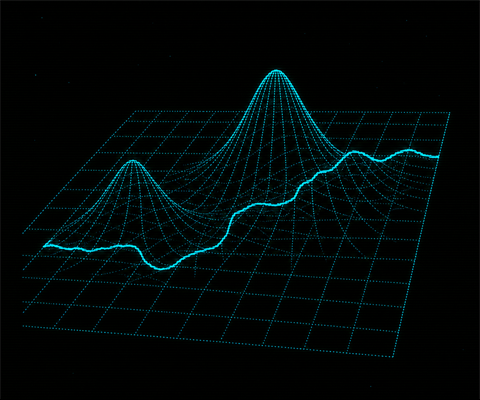{.image-display-block .margin-x-auto .image-blend-screen .image-fit-contain .width-full .image-height-400}

[Spatial]{.text-highlight-spatial}

:::

::: {.column width="33%" .text-position-center .fragment .tui-reveal-scan data-fragment-index="3"}

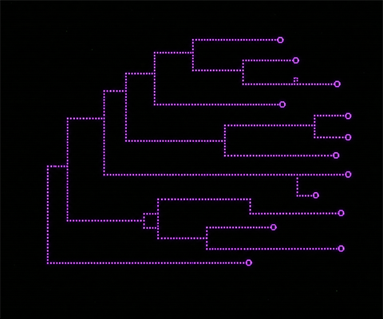{.image-display-block .margin-x-auto .image-blend-screen .image-fit-contain .width-full .image-height-400}

[Taxonomic]{.text-highlight-latent}

:::

::: {.column width="33%" .text-position-center .fragment .tui-reveal-scan data-fragment-index="4"}

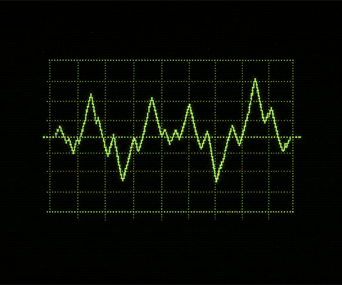{.image-display-block .margin-x-auto .image-blend-screen .image-fit-contain .width-full .image-height-400}

[Temporal]{.text-highlight-temporal}

:::

::::

<br>

::: {.oracle-terminal .fragment data-fragment-index="1"}

::: {.oracle-line}
Three routes selected:
:::

::: {.oracle-line}
[Spatial-resolution runs]{.text-highlight-spatial} : change with spatial scale
:::

::: {.oracle-line}
[Taxonomic aggregation levels]{.text-highlight-latent} : change through classification
:::

::: {.oracle-line}
[Temporal slice tests]{.text-highlight-temporal} : change through time
:::
:::

::: {.notes}
We split the analysis along three axes: spatial scale, from local to continental; taxonomic resolution; and time, from the Last Glacial Maximum to now.
:::

<!-- slide:08a -->

## {.slide-terminal .slide-terminal-story .slide-section-break}

<pre class="fragment section-break-ascii text-color-spatial" data-fragment-index="0" aria-label="Spatial scale">
▄█████ ▄▄▄▄   ▄▄▄ ▄▄▄▄▄▄ ▄▄  ▄▄▄  ▄▄       ▄▄▄▄  ▄▄▄▄  ▄▄▄  ▄▄    ▄▄▄▄▄
▀▀▀▄▄▄ ██▄█▀ ██▀██  ██   ██ ██▀██ ██      ███▄▄ ██▀▀▀ ██▀██ ██    ██▄▄
█████▀ ██    ██▀██  ██   ██ ██▀██ ██▄▄▄   ▄▄██▀ ▀████ ██▀██ ██▄▄▄ ██▄▄▄
</pre>

:::{.notes}
Let's start with the spatial axis.
:::


<!-- slide:08 -->
## [[Spatial results]{.text-color-spatial}: local to continental]{.fragment .fragment-terminal data-fragment-index="0"} {.slide-terminal .slide-terminal-results}

```{r}
#| label: result-slide08-generate
#| include: false
#| cache: true
#| eval: false
source(
  here::here(
    "Documentation/Presentations/BES_2026/R/Visualisation/spatial_units_map_figure.R"
  )
)

source(
  here::here(
    "Documentation/Presentations/BES_2026/R/Visualisation/spatial_association_tiles_figure.R"
  )
)
```

```{r}
#| label: result-slide08-posters
#| eval: false
#| include: false
make_gif_poster("slide_08_spatial_units_map.gif")
```
<!-- Provenance: spatial figures are the October 2026 cross-validated fits (Outputs/Tables/paleo_patterns_unit_2026-10-22.csv). See RESULTS_PROVENANCE.md. -->

:::: {.columns}
::: {.column width="50%"}

::: {.fragment .tui-reveal-blur data-fragment-index="2"}

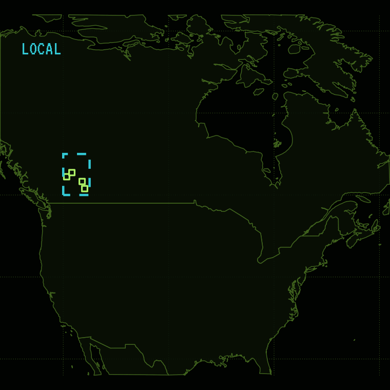{.gif-animated width="100%"}
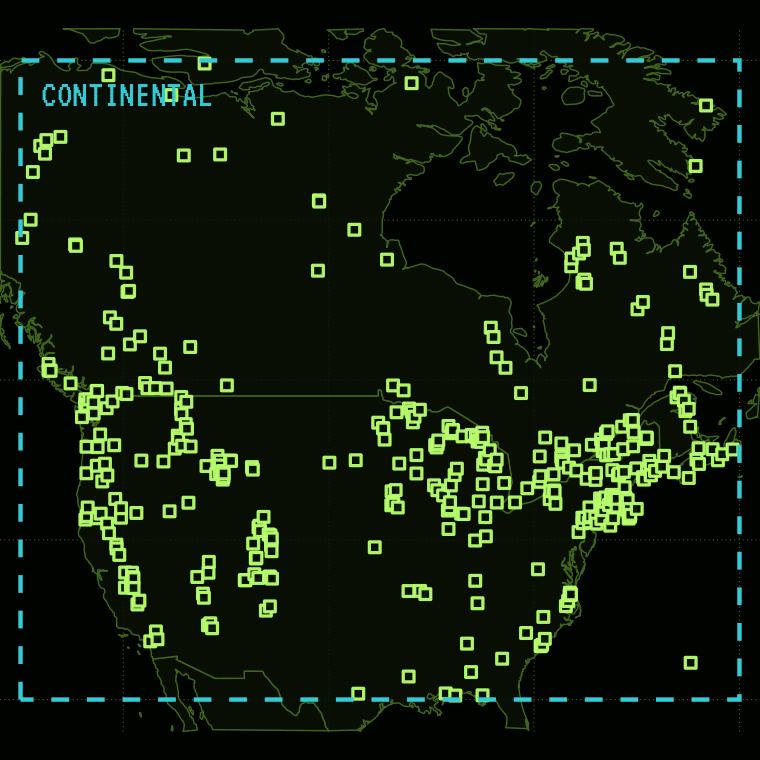{.gif-poster width="100%"}

:::

:::

::: {.column width="50%"}
::: {.fragment .tui-reveal-blur data-fragment-index="3"}

```{r}
#| label: result-slide08-tiles-render
#| echo: false
#| out-width: 100%
knitr::include_graphics(
  here::here(
    "Documentation/Presentations/BES_2026/figures/results/slide_08_spatial_tiles.png"
  )
)
```

:::
:::

::::

::: {.text-color-muted .text-letter-spacing-status .text-position-center}
Results are preliminary
:::

<!-- 

::: {.oracle-terminal .fragment data-fragment-index="1"}

::: {.oracle-line}
[Spatial]{.text-color-spatial} scan configured
:::

::: {.oracle-line}
Units are nested from [local]{.text-emphasis-underline-dotted} to [regional]{.text-emphasis-underline-dotted} to [continental]{.text-emphasis-underline-dotted}
:::
:::

-->

::: {.notes}
ORACLE, show us how the association signal changes from local to continental.
The map shows the nested units: continental models use all data from a continent, regional models a subset, and local models an even smaller one, and each gets its own model.
In the results, the x-axis runs from local on the left to continental on the right, and the y-axis is the share of explained variance that goes to association.
Each point is one model, coloured by the colour triangle, and the purple bar is the median.

Surprisingly, the association signal does not get stronger at the local scale; if anything, the median rises toward the continental scale, although there are only three continental models.
There is a lot of variation between units, and the colours sit between climate and association, so climate stays important everywhere.
:::

<!-- slide:9a -->

## {.slide-terminal .slide-terminal-story .slide-section-break}

<pre class="fragment section-break-ascii text-color-latent" data-fragment-index="0" aria-label="Taxonomic scale">
██████ ▄▄▄  ▄▄ ▄▄  ▄▄▄  ▄▄  ▄▄  ▄▄▄  ▄▄   ▄▄ ▄▄  ▄▄▄▄ 
  ██  ██▀██ ▀█▄█▀ ██▀██ ███▄██ ██▀██ ██▀▄▀██ ██ ██▀▀▀ 
  ██  ██▀██ ██ ██ ▀███▀ ██ ▀██ ▀███▀ ██   ██ ██ ▀████ 
                                                      
           ▄█████  ▄▄▄▄  ▄▄▄  ▄▄    ▄▄▄▄▄                        
           ▀▀▀▄▄▄ ██▀▀▀ ██▀██ ██    ██▄▄                         
           █████▀ ▀████ ██▀██ ██▄▄▄ ██▄▄▄                        
</pre>

:::{.notes}
Now, what if we add the taxonomic axis?
:::

<!-- slide:09 -->
## [How does the [spatial pattern]{.text-color-spatial} change when we add [taxonomic resolution]{.text-color-latent}?]{.fragment .fragment-terminal data-fragment-index="0"} {.slide-terminal .slide-terminal-question}

```{r}
#| label: result-slide09-generate
#| eval: false
#| include: false
#| cache: true
source(
  here::here(
    "Documentation/Presentations/BES_2026/R/Visualisation/spatial_taxonomic_matrix_figure.R"
  )
)
```

::: {.oracle-terminal .fragment  data-fragment-index="1"}

::: {.oracle-line}
Query accepted...
:::

::: {.oracle-line}
Adding [taxonomic axis]{.text-highlight-latent}
:::

::: {.oracle-line}
Plotting the results
:::

:::


::: {.fragment .tui-reveal-blur  data-fragment-index="2"}

```{r}
#| label: result-slide09-matrix-render
#| echo: false
#| out-width: 100%
knitr::include_graphics(
  here::here(
    "Documentation/Presentations/BES_2026/figures/results/slide_09_spatial_taxonomic_matrix.png"
  )
)
```

:::

::: {.notes}
We expected that a coarser taxonomic resolution would change the spatial pattern.
Here are the same units modelled at genus level, at family level, and with taxa replaced by functional types derived from their traits.
Coarser groups shift the whole pattern down: genera have the highest association shares, then families, then functional types.
But the spatial pattern hardly changes: at no resolution is the association signal stronger at the local scale.
:::

<!-- slide:10a -->

## {.slide-terminal .slide-terminal-story .slide-section-break}

<pre class="fragment section-break-ascii text-color-temporal" data-fragment-index="0" aria-label="Temporal scale">
██████ ▄▄▄▄▄ ▄▄   ▄▄ ▄▄▄▄   ▄▄▄  ▄▄▄▄   ▄▄▄  ▄▄    
  ██   ██▄▄  ██▀▄▀██ ██▄█▀ ██▀██ ██▄█▄ ██▀██ ██    
  ██   ██▄▄▄ ██   ██ ██    ▀███▀ ██ ██ ██▀██ ██▄▄▄ 
                                                   
         ▄█████  ▄▄▄▄  ▄▄▄  ▄▄    ▄▄▄▄▄                     
         ▀▀▀▄▄▄ ██▀▀▀ ██▀██ ██    ██▄▄                      
         █████▀ ▀████ ██▀██ ██▄▄▄ ██▄▄▄                     
</pre>

:::{.notes}
Finally, the temporal axis.
:::

<!-- slide:10 -->
## [Is the [association signal]{.text-color-latent} stable through [time]{.text-highlight-temporal}?]{.fragment .fragment-terminal data-fragment-index="0"} {.slide-terminal .slide-terminal-question}

```{r}
#| label: result-slide10-generate
#| include: false
#| cache: true
#| eval: false
source(
  here::here(
    "Documentation/Presentations/BES_2026/R/Visualisation/temporal_density_summary_figure.R"
  )
)

source(
  here::here(
    "Documentation/Presentations/BES_2026/R/Visualisation/network_diagnostic_pipeline_figure.R"
  )
)

source(
  here::here(
    "Documentation/Presentations/BES_2026/R/Visualisation/temporal_model_pipeline_figure.R"
  )
)
```

:::: {.columns}

::: {.column width="35%"}
::: {.oracle-terminal .fragment  data-fragment-index="1"}

::: {.oracle-line}
Query accepted
:::

[]{.oracle-line}

::: {.oracle-line}
[Temporal mode]{.text-highlight-temporal} selected: Slicing the data into [500-year windows]{.text-emphasis-chip}
:::

[]{.oracle-line}

::: {.oracle-line}
[Network diagnostics]{.text-emphasis-underline-dotted} loaded. [Co-occurrence structure]{.text-color-latent} can change even when variance components look similar
:::

[]{.oracle-line}

::: {.oracle-line}
[Each slice]{.text-emphasis-underline-double} receives an [independent analysis and diagnostic workflow]{.text-emphasis-underline-double}
:::

[]{.oracle-line}

::: {.oracle-line}
Plotting the data distribution
:::

[]{.oracle-line}

::: {.oracle-line}
Proceed? [Y]/[N]?
:::

:::
:::

::: {.column width="65%"}

:::{.fragment .tui-reveal-blur  data-fragment-index="2"}

```{r}
#| label: result-slide10-density-render
#| echo: false
#| out-width: 100%
knitr::include_graphics(
  here::here(
    "Documentation/Presentations/BES_2026/figures/results/slide_10_temporal_density.png"
  )
)
```

:::

:::: {.columns .image-height-400}

::: {.column width="50%" .fragment .tui-reveal-blur  data-fragment-index="3"}

```{r}
#| label: result-slide10-temporal-render
#| echo: false
#| out-width: 100%
knitr::include_graphics(
  here::here(
    "Documentation/Presentations/BES_2026/figures/results/slide_10_temporal_pipeline.png"
  )
)
```


:::

::: {.column width="50%" .fragment .tui-reveal-blur  data-fragment-index="4"}

```{r}
#| label: result-slide10-network-render
#| echo: false
#| out-width: 100%
knitr::include_graphics(
  here::here(
    "Documentation/Presentations/BES_2026/figures/results/slide_10_network_example.png"
  )
)
```


:::

::::

:::
::::

::: {.notes}
Is the association signal stable through time?
So far we used the whole fossil record at once.
Now we split it into 500-year slices and fit a separate model to each slice.
For each slice we also compute classic network diagnostics on the bipartite network of taxa and sites, such as connectance and modularity.
:::

<!-- slide:11 -->
## [Temporal trajectories]{.fragment .fragment-terminal data-fragment-index="0"} {.slide-terminal .slide-terminal-results}

```{r}
#| label: result-slide11-generate
#| include: false
#| cache: true
#| eval: false
source(
  here::here(
    "Documentation/Presentations/BES_2026/R/Visualisation/temporal_trajectory_animation_figure.R"
  )
)
```

```{r}
#| label: result-slide11-posters
#| eval: false
#| include: false
make_gif_poster("slide_11_temporal_trajectory_na.gif")
make_gif_poster("slide_11_temporal_trajectory_eu.gif")
make_gif_poster("slide_11_temporal_trajectory_asia.gif")
```

::: {.oracle-terminal .fragment data-fragment-index="1"}

::: {.oracle-line}
Plotting [temporal trajectories]{.text-highlight-temporal} for each [continent]{.text-emphasis-underline-dotted}
:::
:::

<br>

:::: {.columns}
::: {.column width="28%" .fragment .tui-reveal-blur  data-fragment-index="2"}

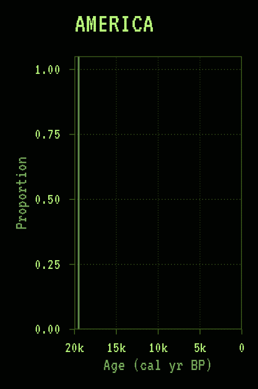{.gif-animated width="100%"}
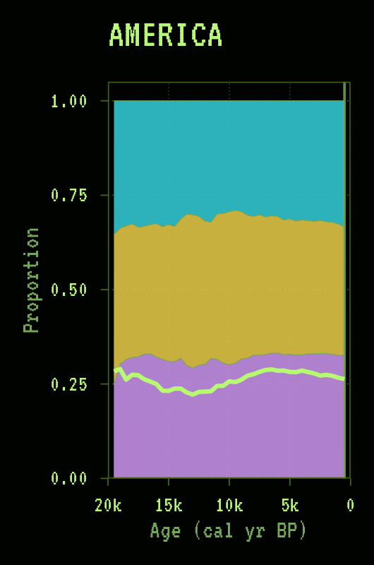{.gif-poster width="100%"}

:::

::: {.column width="28%" .fragment .tui-reveal-blur  data-fragment-index="3"}

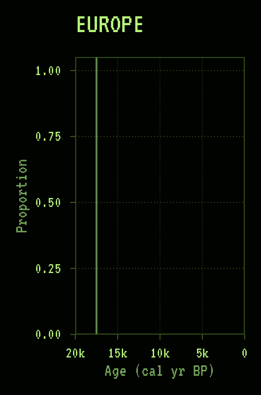{.gif-animated width="100%"}
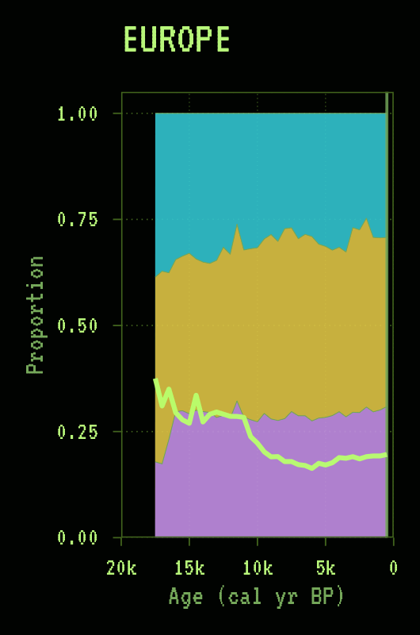{.gif-poster width="100%"}

:::

::: {.column width="28%" .fragment .tui-reveal-blur  data-fragment-index="4"}

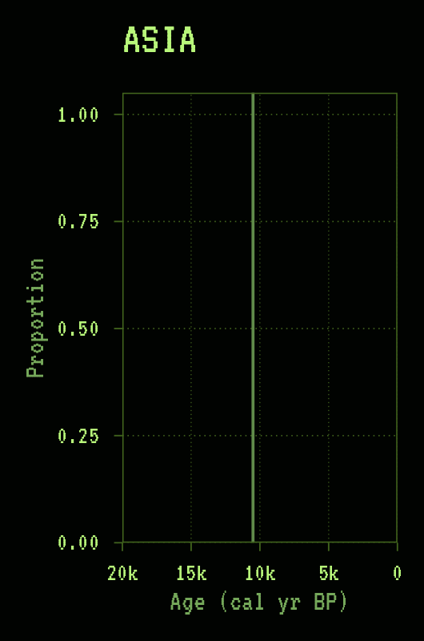{.gif-animated width="100%"}
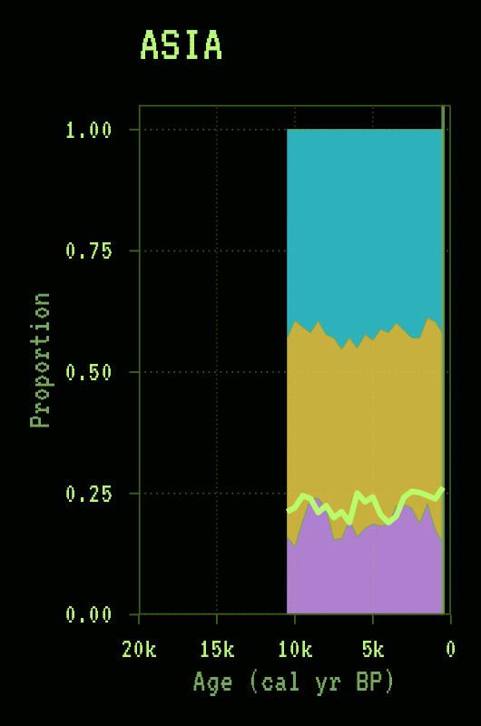{.gif-poster width="100%"}

:::

::: {.column width="16%" .fragment data-fragment-index="2"}

<br>
<br>

```{r}
#| label: result-slide11-legend-render
#| echo: false
#| out-width: 100%
knitr::include_graphics(
  here::here(
    "Documentation/Presentations/BES_2026/figures/results/slide_11_temporal_trajectory_legend.png"
  )
)
```

:::

::::

::: {.notes}
Here are the results for North America, Europe and Asia.
Each step of the animation is one 500-year slice with its own model; the colours show the variance decomposition, and the green line is the modularity of the community network.
Modularity changes through time, for example with the drop around 10,000 years ago in Europe, which may be connected to rapid climate change.
The variance decomposition, in contrast, is surprisingly stable through time on all continents.
:::

<!-- slide:11a -->

## {.slide-terminal .slide-terminal-story .slide-section-break}

<pre class="fragment section-break-ascii text-color-latent" data-fragment-index="0" aria-label="Matrix scale">
▄▄   ▄▄  ▄▄▄  ▄▄▄▄▄▄ ▄▄▄▄  ▄▄ ▄▄ ▄▄   ▄█████  ▄▄▄▄  ▄▄▄  ▄▄    ▄▄▄▄▄
██▀▄▀██ ██▀██   ██   ██▄█▄ ██ ▀█▄█▀   ▀▀▀▄▄▄ ██▀▀▀ ██▀██ ██    ██▄▄
██   ██ ██▀██   ██   ██ ██ ██ ██ ██   █████▀ ▀████ ██▀██ ██▄▄▄ ██▄▄▄
</pre>

:::{.notes}
Before we put the pieces together, ORACLE flagged one more thing: the size of the models themselves.
:::

<!-- slide:11b -->
## [Bigger matrix, more [association]{.text-color-latent}]{.fragment .fragment-terminal data-fragment-index="0"} {.slide-terminal .slide-terminal-results}

```{r}
#| label: result-slide11b-generate
#| include: false
#| eval: false
source(
  here::here(
    "Documentation/Presentations/BES_2026/R/Visualisation/model_size_figures.R"
  )
)
```

:::: {.columns}

::: {.column width="28%"}
::: {.oracle-terminal .fragment data-fragment-index="1"}

::: {.oracle-line}
[Warning]{.text-highlight-warning}: [matrix size]{.text-emphasis-underline} detected as a driver
:::

[]{.oracle-line}

::: {.oracle-line}
Each point: one [fossil-pollen]{.text-emphasis-underline-dotted} spatial model
:::

[]{.oracle-line}

::: {.oracle-line}
More [taxa]{.text-emphasis-chip} in the model, larger [association]{.text-highlight-latent} share
:::

:::
:::

::: {.column width="72%" .fragment .tui-reveal-blur data-fragment-index="2"}

<br>

```{r}
#| label: result-slide11b-render
#| echo: false
#| out-width: 100%
knitr::include_graphics(
  here::here(
    "Documentation/Presentations/BES_2026/figures/results/slide_model_size_a_share_taxa.png"
  )
)
```

:::

::::

::: {.notes}
Every point here is one fossil-pollen spatial model.
The x-axis is the number of taxa in the model, on a log scale; the y-axis is the share of explained variance that goes to association.
The more taxa a model holds, the larger its association share, at every taxonomic resolution.
Taxon number alone explains about two thirds of the variation, and the relationship also holds on a deviance scale and in the models fitted without a penalty on the association term.

Ecologically this makes sense: a taxon modelled with fifty others has more partners that carry information about it.
But it means that the amount of association cannot be compared directly between models of different size.
:::

<!-- slide:12 -->
## [Paleo predictions]{.fragment .fragment-terminal data-fragment-index="0"} {.slide-terminal .slide-terminal-synthesis}

```{r}
#| label: result-slide12-generate
#| include: false
#| cache: true
#| eval: false
source(
  here::here(
    "Documentation/Presentations/BES_2026/R/Visualisation/future_predictions_animation.R"
  )
)
```

```{r}
#| label: result-slide12-posters
#| eval: false
#| include: false
make_gif_poster("slide_12_future_predictions_selected_taxon.gif")
make_gif_poster("slide_12_future_predictions_expected_genus_richness.gif")
```

:::: {.columns}

::: {.column width="50%" .fragment .tui-reveal-scan data-fragment-index="2"}

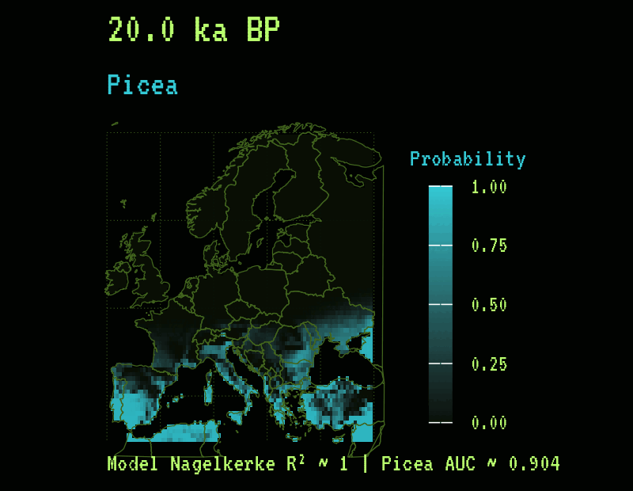{.gif-animated width="100%"}
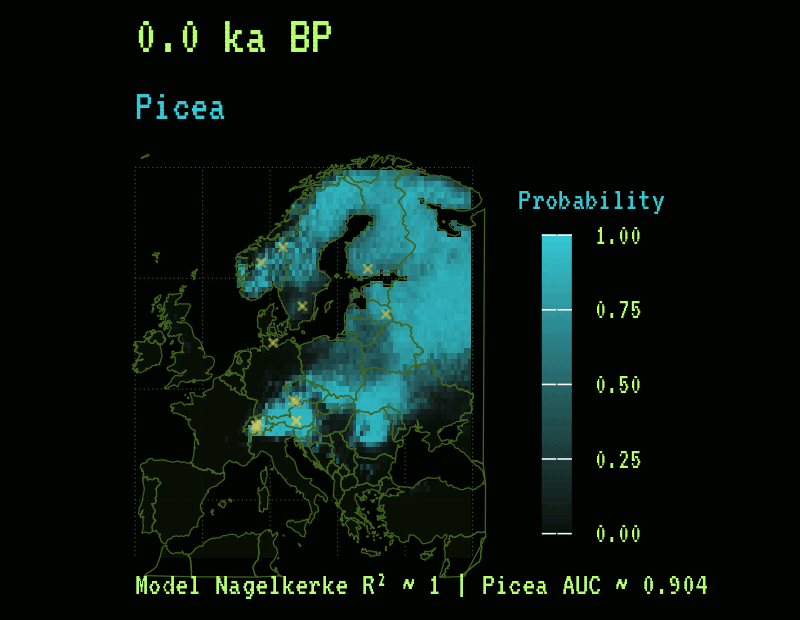{.gif-poster width="100%"}

:::

::: {.column width="50%" .fragment .tui-reveal-scan data-fragment-index="3"}

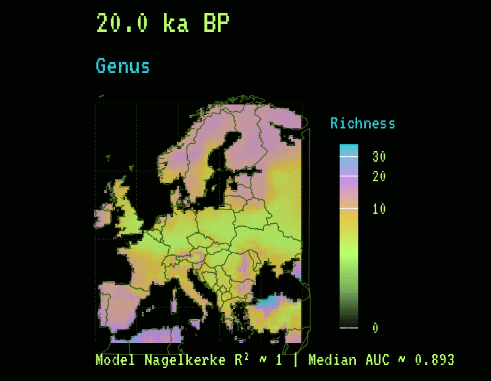{.gif-animated width="100%"}
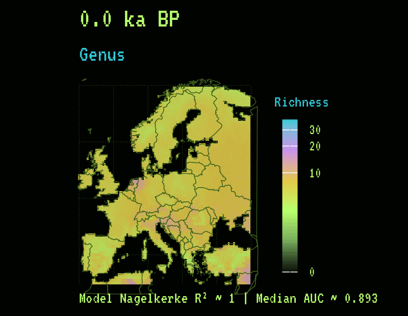{.gif-poster width="100%"}

:::

::::


::: {.oracle-terminal .fragment data-fragment-index="1"}

::: {.oracle-line}
Current [SDM]{.text-emphasis-chip} models can reconstruct [past-to-present]{.text-highlight-temporal} biodiversity patterns and prepare the same machinery for future projection experiments
:::
:::

::: {.notes}
What else can these models do?
Like any species distribution model, they can predict.
Here we predict into the past, using climate, the spatio-temporal structure and the association signal.
On the left is the predicted probability of Picea, spruce, through time, with yellow crosses where it was actually recorded; you can see its northward migration after the Last Glacial Maximum.
On the right is the predicted genus richness.
The logical next step is to use the past to better predict future biodiversity change.
:::

<!-- slide:13 -->
## [Take-home messages]{.fragment .fragment-terminal data-fragment-index="0"} {.slide-terminal .slide-terminal-synthesis}

```{r}
#| label: result-slide13-generate
#| include: false
#| cache: true
#| eval: false
source(
  here::here(
    "Documentation/Presentations/BES_2026/R/Visualisation/synthesis_summary_panel_figure.R"
  )
)
```

::: {.oracle-terminal .fragment data-fragment-index="1"}

::: {.oracle-line}
Summarising RESULTS together: [spatial]{.text-highlight-spatial} patterns, [taxonomic]{.text-highlight-latent} resolution, [temporal]{.text-highlight-temporal} dynamics
:::

::: {.oracle-line}
[Results are preliminary]{.text-highlight-warning}
:::

:::

::: {.fragment data-fragment-index="2" .text-emphasis-box}
I have used [`r number_of_cores` cores]{.text-bold .text-color-spatial} with [`r number_of_samples` spatio-temporal communities]{.text-bold .text-emphasis-box}, [`r number_of_taxa` taxa]{.text-bold .text-color-latent}, and [`r number_trait_values` trait values]{.text-bold .text-color-latent} translated into [`r number_of_functional_types` functional types]{.text-bold .text-color-latent} to fit [`r number_of_models` models]{.text-bold .text-emphasis-underline-double .text-color-red}.
:::

::: {.fragment data-fragment-index="3" .text-emphasis-box}
Palaeoecological data [CAN]{.text-emphasis-underline .text-emphasis-chip} be used to [reconstruct]{.text-emphasis-underline} [past]{.text-emphasis-underline-dotted} [biodiversity]{.text-color-purple} patterns and provide insights into ecological processes.
:::

::: {.fragment data-fragment-index="4" .text-emphasis-box}
[SPACE]{.text-highlight-spatial}: 
The [association signal]{.text-emphasis-underline-dotted .text-color-latent} is [NOT]{.text-emphasis-underline .text-highlight-warning} stronger at [local]{.text-emphasis-underline-dotted} than at [continental]{.text-emphasis-underline-dotted} scales
:::

::: {.fragment data-fragment-index="5" .text-emphasis-box}  
[TAXONOMY]{.text-highlight-latent}: 
Increasing [taxonomic resolution]{.text-color-latent} [DOES]{.text-emphasis-underline .text-emphasis-chip} have an impact on the [spatial pattern]{.text-color-spatial} of the [association signal]{.text-emphasis-underline-dotted .text-color-latent}, but [NOT]{.text-emphasis-underline .text-highlight-warning} in the [expected direction]{.text-emphasis-underline-dotted}
:::

::: {.fragment data-fragment-index="6" .text-emphasis-box}
[TIME]{.text-highlight-temporal}: 
Co-occurrence structure [IS]{.text-emphasis-underline .text-emphasis-chip} responding to major [environmental changes]{.text-highlight-abiotic}, but the [association signal]{.text-emphasis-underline-dotted .text-color-latent} [IS]{.text-emphasis-underline .text-emphasis-chip} surprisingly [stable]{.text-emphasis-underline} through [time]{.text-highlight-temporal}.
:::

::: {.fragment data-fragment-index="7" .text-emphasis-box}
[MATRIX SIZE]{.text-highlight-warning}:
The [association signal]{.text-emphasis-underline-dotted .text-color-latent} [DOES]{.text-emphasis-underline .text-emphasis-chip} grow with the [number of taxa]{.text-emphasis-underline}; compare at [equal size]{.text-emphasis-underline-dotted}
:::

::: {.fragment data-fragment-index="8" .text-emphasis-box}
In addition to contemporary single-species diversity models, [palaeoecological data]{.text-highlight-temporal} can be used to [predict]{.text-emphasis-underline .text-color-red} [future]{.text-emphasis-underline-dotted} [biodiversity]{.text-color-purple} patterns and support [conservation efforts]{.text-emphasis-underline-double}.
:::

::: {.notes}
Let me summarise.
I used 1,130 cores with almost 30,000 spatio-temporal communities, 256 taxa, and almost nine million trait values grouped into 23 functional types, to fit 324 models.
Palaeoecological data can be used to reconstruct past biodiversity patterns and to learn about ecological processes.

In space, the association signal is not stronger at local than at continental scales.
Taxonomic resolution does change the association signal, but not in the expected direction.
Through time, the co-occurrence structure responds to major environmental changes, but the association signal is surprisingly stable.

And a caveat on all of this: the association signal grows with the number of taxa in a model, so it must be compared between models of equal size.
Finally, beyond single-species models, palaeoecological data can help to predict future biodiversity and support conservation.
All of these results are still preliminary.
:::

<!-- slide:14 -->
## [... termination]{.fragment .fragment-terminal data-fragment-index="0"} {.slide-terminal .slide-terminal-story .slide-bg-figure .slide-bg-closing-signal}

<br>
<br>
<br>
<br>
<br>
<br>
<br>
<br>
<br>

::: {.oracle-terminal .fragment data-fragment-index="1"}

::: {.oracle-line}
[Execution complete.]{.text-emphasis-underline}
:::

[]{.oracle-line}

::: {.oracle-line}
Turning off non-essential systems
:::

[]{.oracle-line}

::: {.oracle-line}
[Thank you for your attention]{.text-emphasis-underline-double}
:::

[]{.oracle-line}

::: {.oracle-line}
...
:::

:::

::: {.notes}
This is all the time we have with the supercomputer.
ORACLE is shutting down.
:::

<!-- slide:15 -->
## Presenter {.slide-title .screen-corners .screen-header .screen-prompt}


:::: {.columns}

::: {.column width="5%"}
:::

::: {.column width="35%"}

::: {.image-height-350 .image-position-center}
{.image-theme-bg-dark top=0 left=100}
:::

::: {.text-position-center .text-size-heading}
[Hi!]{.text-color-amber} I am [Ondřej Mottl]{.text-color-purple .text-bold}
:::

* 🌐 [ondrejmottl.github.io](https://ondrejmottl.github.io/)
* 📧 [ondrej.mottl(at)natur.cuni.cz](mailto:ondrej.mottl(at)natur.cuni.cz)
* 🦋 [ondrejmottl.bsky.social](https://bsky.app/profile/ondrejmottl.bsky.social)

:::

::: {.column width="1%"}
:::

::: {.column width="59%" .text-position-center .text-size-body-large}

<br>

Assistant Professor at 🏛️[Charles University](https://cuni.cz/UK-1.html), Prague, 🇨🇿

<br>

Head of the 🧑‍💻[Laboratory of Quantitative Ecology](https://ondrejmottl.github.io/lab/about_the_lab.html)

<br>

Interested in [macroecology]{.text-emphasis-caps .text-emphasis-chip .text-color-cyan}, [palaeoecology]{.text-emphasis-caps .text-emphasis-chip .text-color-amber}, [biodiversity]{.text-emphasis-caps .text-emphasis-chip .text-color-purple}, and [data science]{.text-emphasis-caps .text-emphasis-chip .text-color-red}

<br>
<br>

:::: {.columns}

::: {.column width="10%"}
:::

::: {.column width="40%"}

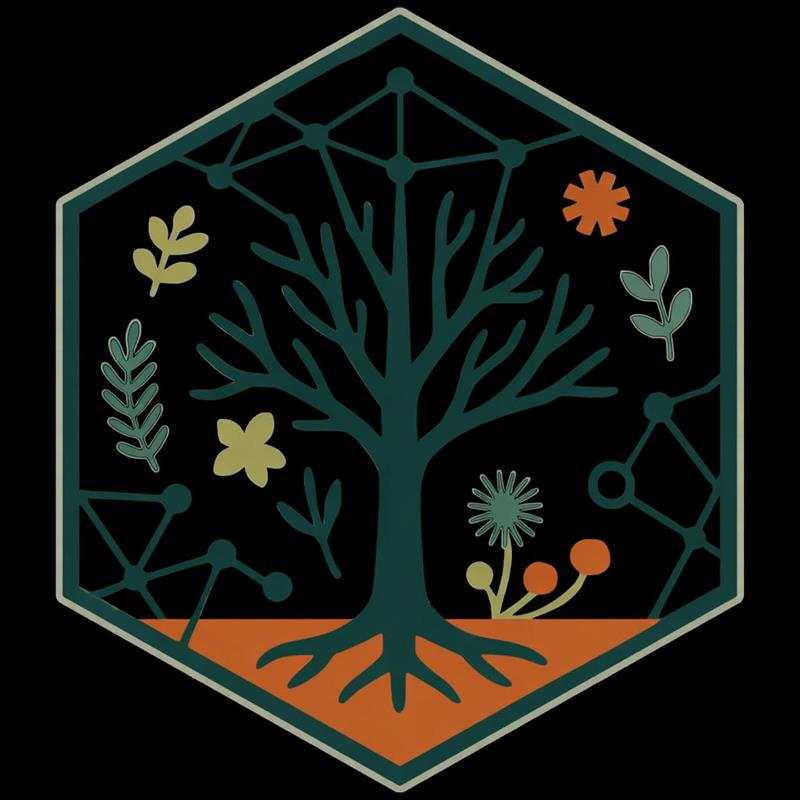{.image-display-block .image-theme-bg-dark top=0 left=50 width="250" height="250"}

:::

::: {.column width="40%"}
```{r}
#| label: QR code https://bit.ly/ondrej_mottl 
#| echo: false
#| eval: false
#| output: false
#| cache: true
save_qr_code(
  url = "https://bit.ly/ondrej_mottl",
  name = "personal_web",
  background_color = vec_oracle_palette[["background"]],
  foreground_color = vec_oracle_palette[["phosphor"]],
  plot = FALSE
)
```

{.image-display-block top=0 right=0 width="250" height="250"}

:::

::: {.column width="10%"}
:::

::::

:::

::::


::: {.notes}
My name is Ondřej Mottl.
I am an assistant professor at Charles University in Prague, where I lead the Laboratory of Quantitative Ecology.
To find out more about my work and my lab, scan the QR code.
I am happy to talk about any of these topics, so please get in touch.
:::

<!-- slide:16 -->
## Presentation availability {.slide-title .screen-corners .screen-header .screen-prompt}

[This presentation is publicly available on the BIODYNAMICS project website]{.text-weight-heading .text-line-height-title .margin-bottom-large .text-shadow-dim .text-uppercase .text-size-heading .text-color-purple .text-emphasis-box .text-position-center}

:::: {.columns}

::: {.column width="25%"}
:::

::: {.column width="25%"}
{.image-theme-bg-dark height="280" width="280" .image-position-center}
:::

::: {.column width="25%"}

```{r}
#| label: QR code https://bit.ly/BIODYNAMICS_project 
#| echo: false
#| eval: false
#| output: false
#| cache: true
save_qr_code(
  url = "https://bit.ly/BIODYNAMICS_project",
  name = "biodynamics_web",
  background_color = vec_oracle_palette[["background"]],
  foreground_color = vec_oracle_palette[["phosphor"]],
  plot = FALSE
)
```

{.image-display-block width="300" height="300" .image-position-center}
:::

::: {.column width="25%"}
:::

::::

:::: {.columns}
::: {.column width="30%"}
:::

::: {.column width="60%" .image-position-center}

::: {.text-letter-spacing-status .text-bold .r-fit-text}
[bit.ly/BIODYNAMICS_project](https://bit.ly/BIODYNAMICS_project)
:::

:::

::: {.column width="30%"}
:::

::::

<br>

[PDF backup contains static figures only; use the HTML deck for animations]{.display-block .text-position-center .text-color-amber .text-weight-heading .text-size-title-small .margin-bottom-large}  

::: {.text-color-muted .text-letter-spacing-status .text-uppercase .text-position-center}
MIT LICENSE | Supported by [Czech Science Foundation](https://gacr.cz/en/) grant GN23-06386I
:::

::: {.notes}
This presentation is part of the BIODYNAMICS project.
Everything, including this presentation, is publicly available on the project website and fully reproducible.
You can scan the QR code or go to bit.ly/BIODYNAMICS_project.
:::

<!-- slide:17 -->
## BIODYNAMICS PROJECT {.slide-title .slide-planet-bg .screen-corners .screen-header .screen-prompt .screen-link-oracle}

::: {.planet-scanlines}
:::

:::: {.columns}
::: {.column .panel-line-left .padding-left-large .padding-top-small .padding-bottom-small width="100%"}

[talking to \<ORACLE\>:]{.display-block .text-weight-heading .text-line-height-title .margin-bottom-large .text-shadow-dim .text-uppercase .text-size-heading .text-color-cyan}

[Exploring biotic signals in vegetation assembly from the LGM to the Anthropocene]{.display-block .text-weight-heading .text-line-height-title .margin-bottom-large .text-uppercase .text-size-heading-large .text-color-green .text-shadow .text-line-under .padding-bottom-large}

<br>
<br>

[Ondrej Mottl]{.text-size-title .text-color-purple}

[BES Annual Meeting 2026 || 14–17 December 2026 || Online]{.text-size-title-small .text-color-amber}

<br>
<br>
<br>

:::

::::

:::: {.columns .panel-line-top .margin-top-large .padding-top-small}

::: {.column width="33%"}
::: {.text-color-muted .text-letter-spacing-status .text-uppercase .text-position-center}
NARRATIVE INTERFACE: **ORACLE**
:::
:::

::: {.column width="33%" .text-position-center .text-color-muted}
.../.../...
:::

::: {.column width="33%"}
::: {.text-color-muted .text-letter-spacing-status .text-uppercase .text-position-center}
ANALYTICAL  OUTPUTS: **REAL**
:::
:::

::::

::: {.notes}
Thank you very much for your attention.
I am looking forward to your questions and comments.
:::

<!-- slide:S00 -->

## {.slide-terminal .slide-terminal-story .slide-section-break}

<pre class="section-break-ascii text-color-temporal" aria-label="Extra slides">                                 
██████ ▄▄ ▄▄ ▄▄▄▄▄▄ ▄▄▄▄   ▄▄▄   
██▄▄   ▀█▄█▀   ██   ██▄█▄ ██▀██  
██▄▄▄▄ ██ ██   ██   ██ ██ ██▀██  
                                 
 ▄▄▄▄ ▄▄    ▄▄ ▄▄▄▄  ▄▄▄▄▄  ▄▄▄▄ 
███▄▄ ██    ██ ██▀██ ██▄▄  ███▄▄ 
▄▄██▀ ██▄▄▄ ██ ████▀ ██▄▄▄ ▄▄██▀ 
</pre>

<!-- slide:11c -->
## [[Climate]{.text-color-abiotic} versus [space]{.text-color-spatial}: no size effect]{.fragment .fragment-terminal data-fragment-index="0"} {.slide-terminal .slide-terminal-results}

:::: {.columns}

::: {.column width="28%"}
::: {.oracle-terminal .fragment data-fragment-index="1"}

::: {.oracle-line}
Control query: [climate]{.text-highlight-abiotic} / ([climate]{.text-highlight-abiotic} + [space]{.text-highlight-spatial})
:::

[]{.oracle-line}

::: {.oracle-line}
Result: flat
:::

[]{.oracle-line}

::: {.oracle-line}
The size effect is specific to [association]{.text-highlight-latent}
:::

:::
:::

::: {.column width="72%" .fragment .tui-reveal-blur data-fragment-index="2"}

<br>

```{r}
#| label: result-slide11c-render
#| echo: false
#| out-width: 100%
knitr::include_graphics(
  here::here(
    "Documentation/Presentations/BES_2026/figures/results/slide_model_size_b_climate_balance.png"
  )
)
```

:::

::::

::: {.notes}
Is this simply a property of bigger models?
As a control, I looked at the balance between the other two components: the climate part divided by the climate plus space parts.
This balance does not change with the number of taxa; the lines are flat.
So the size effect is specific to the association component, and the balance between climate and space can be compared between models as it is.
:::

<!-- slide:11d -->
## [At equal [matrix size]{.text-emphasis-underline}, the gradient reverses]{.fragment .fragment-terminal data-fragment-index="0"} {.slide-terminal .slide-terminal-results}

:::: {.columns}

::: {.column width="28%"}
::: {.oracle-terminal .fragment data-fragment-index="1"}

::: {.oracle-line}
[Continental]{.text-highlight-spatial} models hold about four times more genera than [local]{.text-highlight-spatial} ones
:::

[]{.oracle-line}

::: {.oracle-line}
Adjusting every extent to the same number of taxa
:::

:::
:::

::: {.column width="72%" .fragment .tui-reveal-blur data-fragment-index="2"}

<br>

```{r}
#| label: result-slide11d-render
#| echo: false
#| out-width: 100%
knitr::include_graphics(
  here::here(
    "Documentation/Presentations/BES_2026/figures/results/slide_model_size_c_equal_taxa.png"
  )
)
```

:::

::::

::: {.notes}
And this matters for the spatial result, because continental models simply hold more taxa: a median of about fifty genera, against about twelve in local models.
The dashed green line is the raw median association share for genera, the pattern we saw earlier.
The purple line is the share predicted for models of equal size, from a model that holds taxon number, resolution, extent and continent.

At equal size, the gradient reverses into the decline with extent that I originally expected.
This is a model-based adjustment and still preliminary, but it shows that the scale question has to be asked at equal matrix size.
:::

<!-- slide:11e -->
## [Same genera across nested extents: [first look]{.text-highlight-warning}]{.fragment .fragment-terminal data-fragment-index="0"} {.slide-terminal .slide-terminal-results}

:::: {.columns}

::: {.column width="28%"}
::: {.oracle-terminal .fragment data-fragment-index="1"}

::: {.oracle-line}
Following the [same genera]{.text-emphasis-underline} from a unit to the unit that contains it
:::

[]{.oracle-line}

::: {.oracle-line}
Open symbols: difference at [equal model size]{.text-emphasis-chip}
:::

[]{.oracle-line}

::: {.oracle-line}
[Exploratory]{.text-highlight-warning}: not for quoting yet
:::

:::
:::

::: {.column width="72%" .fragment .tui-reveal-blur data-fragment-index="2"}

<br>

```{r}
#| label: result-slide11e-render
#| echo: false
#| out-width: 100%
knitr::include_graphics(
  here::here(
    "Documentation/Presentations/BES_2026/figures/results/slide_model_size_d_nested_extent.png"
  )
)
```

:::

::::

::: {.notes}
A second way around the size effect is to follow the same genera from a local unit to its region, and from the region to its continent, and compare their association shares.
Each point is one unit.
The larger model mostly gives the higher share, but the difference grows with how many more taxa it holds, so most of it is again the size effect.

The open symbols show the difference at equal model size: about zero in fossil pollen, but clearly negative in modern vegetation plots, where association therefore declines with extent.
This is a first look, so please do not quote it yet.
:::

<!-- slide:11f -->
## [And through [time]{.text-highlight-temporal}?]{.fragment .fragment-terminal data-fragment-index="0"} {.slide-terminal .slide-terminal-results}

```{r}
#| label: result-slide11f-generate
#| include: false
#| eval: false
source(
  here::here(
    "Documentation/Presentations/BES_2026/R/Visualisation/temporal_taxa_share_figure.R"
  )
)
```

:::: {.columns}

::: {.column width="28%"}
::: {.oracle-terminal .fragment data-fragment-index="1"}

::: {.oracle-line}
[Taxa per slice]{.text-emphasis-chip} rise toward the present
:::

[]{.oracle-line}

::: {.oracle-line}
Fewest taxa, lowest [association]{.text-highlight-latent} shares
:::

:::
:::

::: {.column width="72%" .fragment .tui-reveal-blur data-fragment-index="2"}

<br>

```{r}
#| label: result-slide11f-render
#| echo: false
#| out-width: 100%
knitr::include_graphics(
  here::here(
    "Documentation/Presentations/BES_2026/figures/results/slide_model_size_e_taxa_through_time.png"
  )
)
```

:::

::::

::: {.notes}
The same applies through time.
On the left, the number of taxa per 500-year slice rises toward the present in North America and Europe, while northern Asia stays below ten.
On the right, the slices and the continent with the fewest taxa have the lowest association shares.
So the dips in the temporal trajectories, and the lower shares in Asia, cannot yet be separated from matrix size.
The next step is to compare the same taxa through time.
:::

## Results of contemporary data {.slide-terminal .slide-terminal-results}

<br>
<br>

```{r}
#| label: extra-slide01-generate
#| eval: false
#| include: false
#| cache: true
source(
  here::here(
    "Documentation/Presentations/BES_2026/R/Visualisation/Extra/modern_spatial_taxonomic_matrix_figure.R"
  )
)
```

```{r}
#| label: extra-slide01-modern-matrix-render
#| echo: false
#| out-width: 80%
knitr::include_graphics(
  here::here(
    "Documentation/Presentations/BES_2026/figures/results/extra/slide_extra_01_modern_spatial_taxonomic_matrix.png"
  )
)
```

## Is it a issue of model quality? {.slide-terminal .slide-terminal-results}

<br>

```{r}
#| label: extra-slide02-model-quality-generate
#| eval: false
#| include: false
#| cache: true
source(
  here::here(
    "Documentation/Presentations/BES_2026/R/Visualisation/Extra/spatial_association_model_quality_figure.R"
  )
)
```

```{r}
#| label: extra-slide02-spatial-model-quality-render
#| echo: false
#| out-width: 100%
knitr::include_graphics(
  here::here(
    "Documentation/Presentations/BES_2026/figures/results/extra/slide_extra_02_spatial_association_model_quality.png"
  )
)
```

## Is there relationship between species-species association and network modularity? {.slide-terminal .slide-terminal-results}

<br>

```{r}
#| label: extra-slide02-generate
#| eval: false
#| include: false
#| cache: true
source(
  here::here(
    "Documentation/Presentations/BES_2026/R/Visualisation/Extra/temporal_association_modularity_figure.R"
  )
)
```

```{r}
#| label: extra-slide02-temporal-association-modularity-render
#| echo: false
#| out-width: 100%
knitr::include_graphics(
  here::here(
    "Documentation/Presentations/BES_2026/figures/results/extra/slide_extra_02_temporal_association_modularity.png"
  )
)
```

## Is there relationship between network modularity and network size? {.slide-terminal .slide-terminal-results}

<br>

```{r}
#| label: extra-slide03-generate
#| eval: false
#| include: false
#| cache: true
source(
  here::here(
    "Documentation/Presentations/BES_2026/R/Visualisation/Extra/temporal_network_size_modularity_figure.R"
  )
)
```

```{r}
#| label: extra-slide03-temporal-network-size-modularity-render
#| echo: false
#| out-width: 100%
knitr::include_graphics(
  here::here(
    "Documentation/Presentations/BES_2026/figures/results/extra/slide_extra_03_temporal_network_size_modularity.png"
  )
)
```

## How good predictor is the climate? {.slide-terminal .slide-terminal-results}

<br>

```{r}
#| label: extra-slide04-climate-parameters-generate
#| eval: false
#| include: false
#| cache: true
source(
  here::here(
    "Documentation/Presentations/BES_2026/R/Visualisation/Extra/spatial_climate_parameters_auc_figure.R"
  )
)
```

```{r}
#| label: extra-slide04-climate-parameters-render
#| echo: false
#| out-width: 100%
knitr::include_graphics(
  here::here(
    "Documentation/Presentations/BES_2026/figures/results/extra/slide_extra_04_spatial_climate_parameters_auc.png"
  )
)
```

## How are the Functional Types generated ?{.slide-terminal .slide-terminal-results}

<br>

```{r}
#| label: extra-slide05-functional-type-nmds-generate
#| eval: false
#| include: false
#| cache: true
source(
  here::here(
    "Documentation/Presentations/BES_2026/R/Visualisation/Extra/functional_type_nmds_figure.R"
  )
)
```

```{r}
#| label: extra-slide05-functional-type-nmds-render
#| echo: false
#| out-width: 100%
knitr::include_graphics(
  here::here(
    "Documentation/Presentations/BES_2026/figures/results/extra/slide_extra_05_functional_type_nmds.png"
  )
)
```
